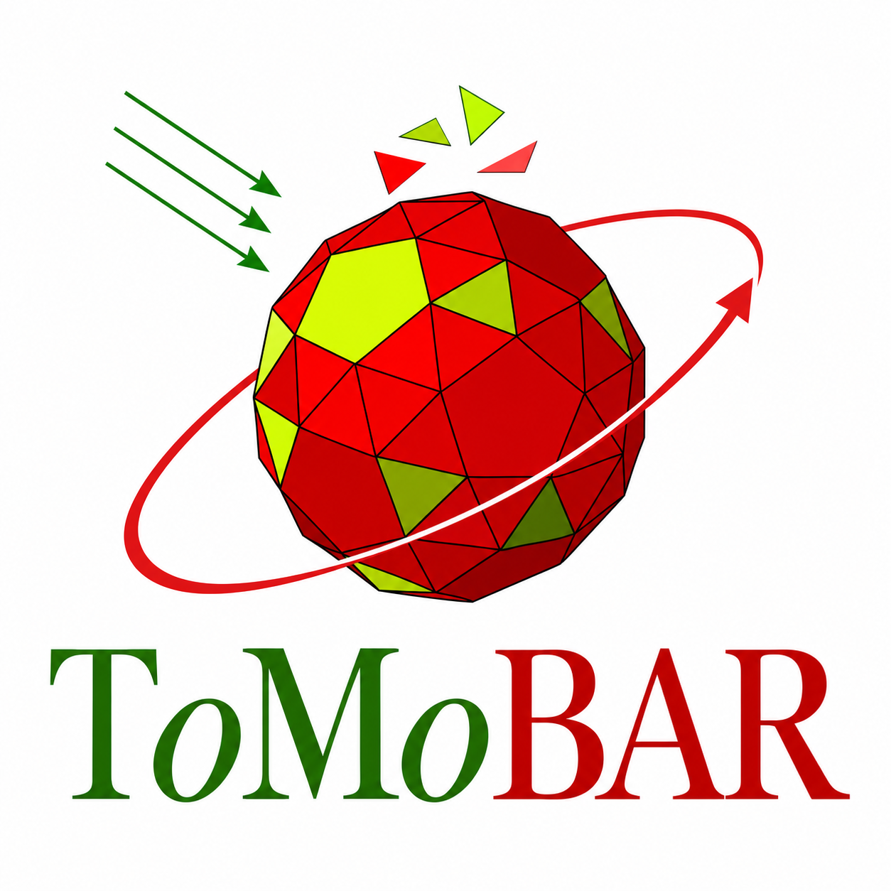

.. warning::

   **BREAKING API CHANGE: this refactored version is incompatible with previous versions.**

   Imports, reconstruction classes, geometry setup, solver arguments and numerical
   behaviour have changed substantially. Existing scripts and integrations must
   be migrated; compatibility aliases for the old API are not provided.

   This breaking change was necessary to support more flexible acquisition
   geometry, enabling iterative alignment and laminography workflows that are
   now available in ToMoBAR. No breaking API changes are expected in near future.

   **Before upgrading**, read the `changelog
   <https://github.com/dkazanc/ToMoBAR/blob/master/CHANGELOG.md>`_ and
   `migration guide <https://dkazanc.github.io/ToMoBAR/howto/migration.html>`_.

ToMoBAR
========

**TOmographic MOdel-BAsed Reconstruction** provides GPU-accelerated direct and
iterative reconstruction for parallel-beam tomography and laminography, with
native regularisation, alignment and geometry tools.

|conda-build| |conda-version| |conda-release| |conda-platforms| |conda-downloads|

Reconstruction requires a CUDA-capable NVIDIA GPU. Geometry visualisation and
NumPy preprocessing can run without a GPU.

Documentation
-------------

Start with the `main documentation <https://dkazanc.github.io/ToMoBAR/>`_.

* `Installation <https://dkazanc.github.io/ToMoBAR/getting_started/installation.html>`_
  and `requirements <https://dkazanc.github.io/ToMoBAR/getting_started/requirements.html>`_.
* `Tutorial notebooks <https://dkazanc.github.io/ToMoBAR/tutorials/index.html>`_
  with saved results, and `standalone demos
  <https://github.com/dkazanc/ToMoBAR/blob/master/demos/README.rst>`_.
* `API reference <https://dkazanc.github.io/ToMoBAR/reference/api.html>`_
  and `method guides <https://dkazanc.github.io/ToMoBAR/howto/reconstruction.html>`_.
* `Citation and bibliography
  <https://dkazanc.github.io/ToMoBAR/reference/bibliography.html>`_.

For broader processing pipelines, see
`HTTomolibGPU <https://diamondlightsource.github.io/httomolibgpu/>`_ and
`HTTomo <https://diamondlightsource.github.io/httomo/>`_.

.. |conda-build| image:: https://github.com/dkazanc/ToMoBAR/actions/workflows/tomobar_conda_upload.yml/badge.svg
   :target: https://github.com/dkazanc/ToMoBAR/actions/workflows/tomobar_conda_upload.yml
   :alt: Conda build and publication

.. |conda-version| image:: https://anaconda.org/httomo/tomobar/badges/version.svg
   :target: https://anaconda.org/httomo/tomobar/
   :alt: Conda package version

.. |conda-release| image:: https://anaconda.org/httomo/tomobar/badges/latest_release_date.svg
   :target: https://anaconda.org/httomo/tomobar/
   :alt: Latest Conda release

.. |conda-platforms| image:: https://anaconda.org/httomo/tomobar/badges/platforms.svg
   :target: https://anaconda.org/httomo/tomobar/
   :alt: Conda platforms

.. |conda-downloads| image:: https://anaconda.org/httomo/tomobar/badges/downloads.svg
   :target: https://anaconda.org/httomo/tomobar/
   :alt: Conda downloads
