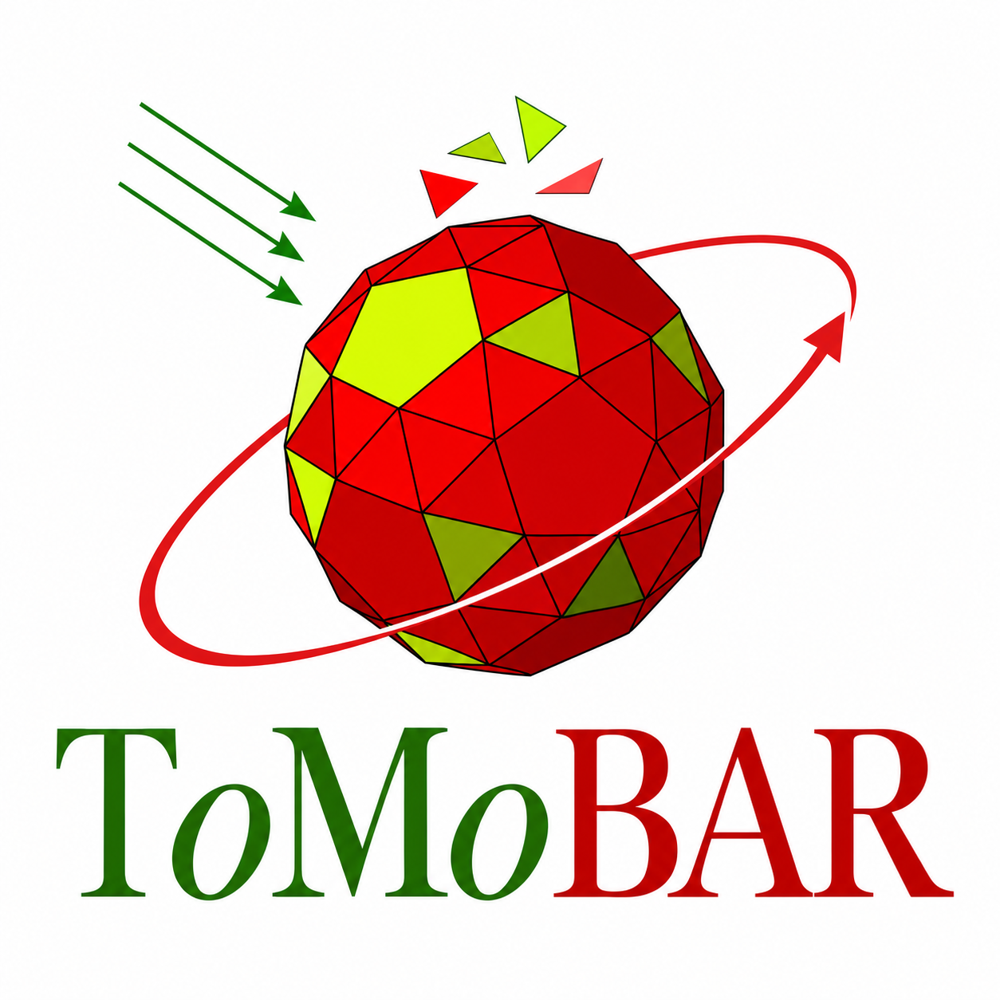
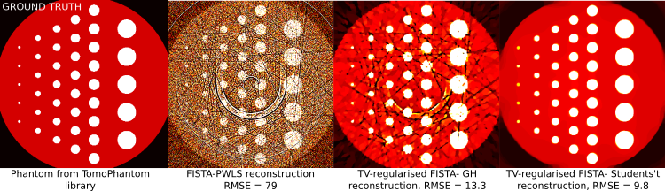
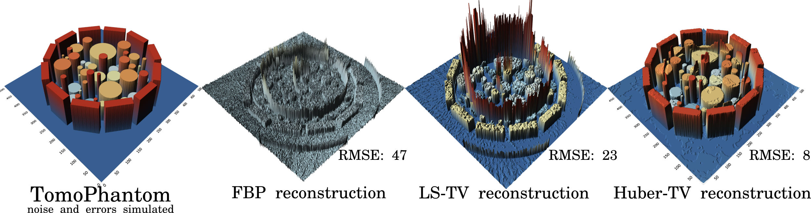

<picture>
  <source media="(prefers-color-scheme: dark)" srcset="docs/source/_static/tomobar_logo_v3_dark.png">
  
</picture>

# ToMoBAR

**TOmographic MOdel-BAsed Reconstruction** is a Python library for GPU-accelerated
direct and model-based iterative reconstruction of parallel-beam tomography and
laminography data.

| Master | Anaconda binaries |
|--------|-------------------|
|  |    |

## Capabilities

- Explicit projection and volume geometry, with centre-of-rotation corrections,
  per-view detector shifts and general parallel vectors.
- FBP in 2D and 3D, plus Fourier inversion for supported 3D tomography scans.
- Landweber, SIRT, CGLS, FISTA, ADMM and OSEM for 3D iterative reconstruction.
- ASTRA projection/backprojection for flexible geometry and laminography; USFFT
  for supported angle-based tomography with scalar centre-of-rotation corrections.
- LS, PWLS and SWLS data fidelities for FISTA and ADMM. FISTA supports ordered
  subsets; ADMM uses full-data updates with linearised or conjugate-gradient
  data solves, relaxation and optional residual stopping.
- Bundled CuPy regularisers: ROF-TV, PD-TV, split-Bregman TV, fast-gradient
  projection TV, TGV and nonlinear diffusion. CCPi-Regularisation-Toolkit is
  not required.
- Geometry visualisation, reconstruction-energy diagnostics, solver continuation
  and per-view translation alignment.

Direct forward projection, backprojection and FBP accept NumPy or CuPy arrays and
return the same array library. Iterative methods accept either and return CuPy
images. Geometry visualisation and NumPy preprocessing can run without a GPU;
reconstruction requires a CUDA-capable NVIDIA GPU.

## Requirements and installation

The package declares Python >=3.12, NumPy >=2, CuPy >=14 and ASTRA Toolbox >=2.5,
plus SciPy, scikit-image and Pillow. Choose Python and CUDA versions supported by
your CuPy and ASTRA distributions. Matplotlib is optional for plotting; JupyterLab
and a Python kernel are needed to run notebooks interactively.

Follow the [installation guide](https://dkazanc.github.io/ToMoBAR/getting_started/installation.html)
and [requirements](https://dkazanc.github.io/ToMoBAR/getting_started/requirements.html).
For changes to imports, geometry and solver calls, use the
[migration guide](https://dkazanc.github.io/ToMoBAR/howto/migration.html).
See [CHANGELOG.md](CHANGELOG.md) for release details.

## Learn and run examples

Start with the [notebook tutorials](https://dkazanc.github.io/ToMoBAR/tutorials/index.html):
geometry visualisation, synthetic 3D tomography, and synthetic laminography with
FBP and CGLS. They contain saved results and generate their own inputs; no
experimental dataset or TomoPhantom installation is required.

Notebook sources are in [docs/source/tutorials](docs/source/tutorials).
Standalone scripts are grouped by topic in [demos](demos/README.rst), including
experimental datasets, alignment, regularisation and solver diagnostics.

## Related software

[HTTomolibGPU](https://diamondlightsource.github.io/httomolibgpu/) provides GPU
processing pipelines and reconstruction wrappers. [HTTomo](https://diamondlightsource.github.io/httomo/)
provides a larger processing framework with MPI-based distributed execution.
ToMoBAR exposes device selection but does not itself split a reconstruction
across GPUs or MPI processes. Check downstream wrapper compatibility when
upgrading to the current API.

## Historical illustrations

These images are retained from earlier ToMoBAR versions. They do not demonstrate
the current supported fidelity settings or current numerical results; use the
executed notebook tutorials for current examples.

  

  

## Citation

[D. Kazantsev and N. Wadeson (2020), Tomographic MOdel-BAsed Reconstruction
(ToMoBAR) software for high resolution synchrotron X-ray tomography, CT Meeting
2020](https://github.com/dkazanc/ToMoBAR/blob/master/docs/Kazantsev_CT_20.pdf).
