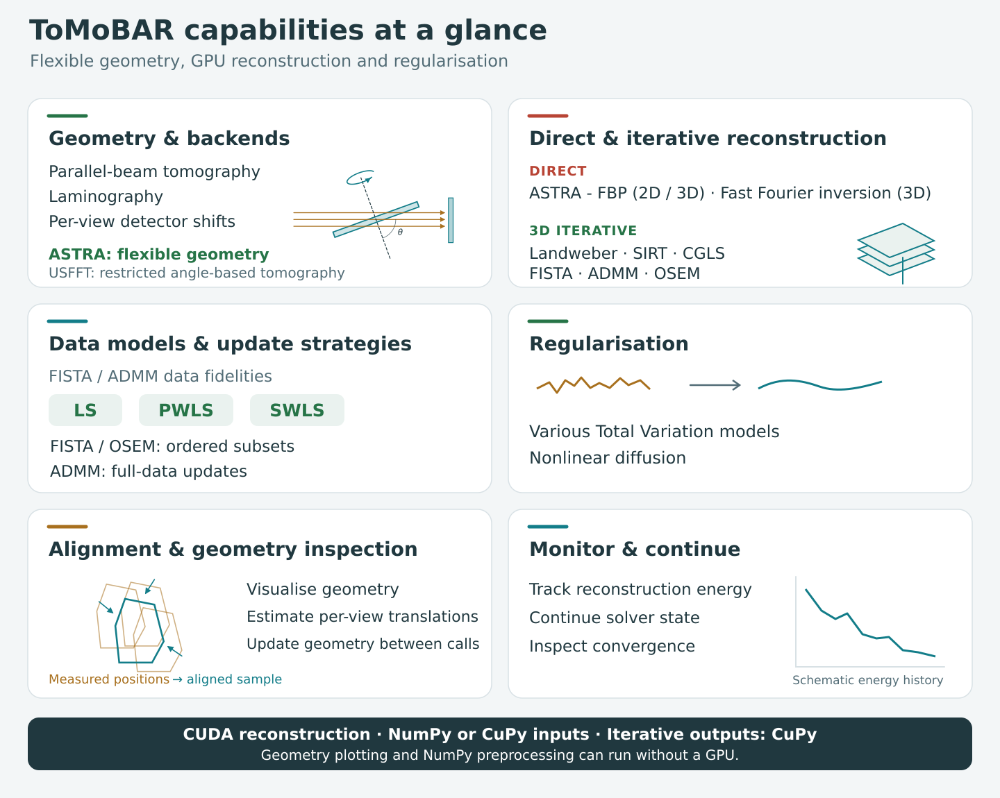
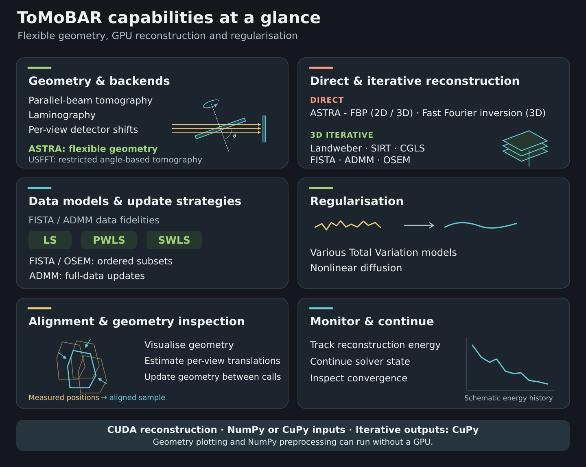

.. _intro_about:

What ToMoBAR does
=================

ToMoBAR is a Python library for direct and model-based iterative reconstruction
of parallel-beam tomography and laminography data. ToMoBAR uses CUDA-capable NVIDIA GPUs for
fast forward projection, backprojection, direct and iterative reconstruction. It also
provides explicit geometry objects, projection operators and reconstruction with regularisers.

ribution graphs. Iterative updates are illustrated on a two-dimensional objective field approaching a global minimum. Reconstruction requires CUDA; USFFT has method and geometry restrictions.

ribution graphs. Iterative updates are illustrated on a two-dimensional objective field approaching a global minimum. Reconstruction requires CUDA; USFFT has method and geometry restrictions.

Detailed capabilities
---------------------

* Use FBP for 2D and 3D parallel-beam tomography, or Fourier inversion for
  supported 3D scans.
* Reconstruct 3D data iteratively with Landweber, SIRT, CGLS, FISTA, ADMM and OSEM.
* Configure LS, PWLS and SWLS data fidelities for FISTA and ADMM. FISTA supports
  ordered subsets; ADMM always uses all views.
* Apply native Total Variation penalties: PD-TV, split-Bregman TV, fast-gradient projection TV,
  TGV and nonlinear diffusion regularisation. See
  :class:`tomobar.options.Regularisation` for method-specific settings.
* Use ASTRA for flexible geometry, detector shifts and laminography, or USFFT
  for supported angle-based tomography. See :doc:`../concepts/backends`.
* Inspect geometry, track reconstruction energy, continue solver state and
  estimate per-view translation alignment.

Where it fits
-------------

ToMoBAR is used in the Diamond Light Source imaging software stack through
`HTTomolibGPU <https://diamondlightsource.github.io/httomolibgpu/>`_ and
`HTTomo <https://diamondlightsource.github.io/httomo/>`_. Its reconstruction
methods build on ASTRA [VanAarle2015]_ and GPU Fourier techniques [NIKITIN2017]_.
See the :doc:`bibliography <../reference/bibliography>` for related work.

Continue with :doc:`installation`, then :doc:`first_reconstruction`.
