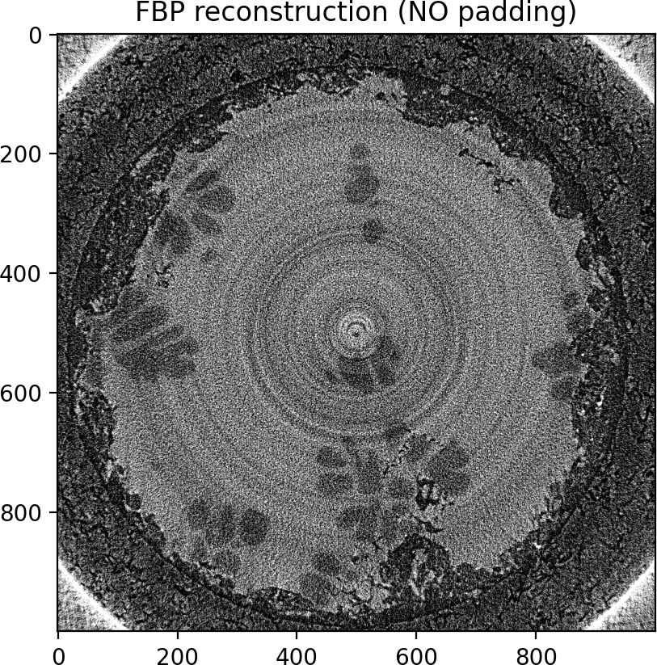
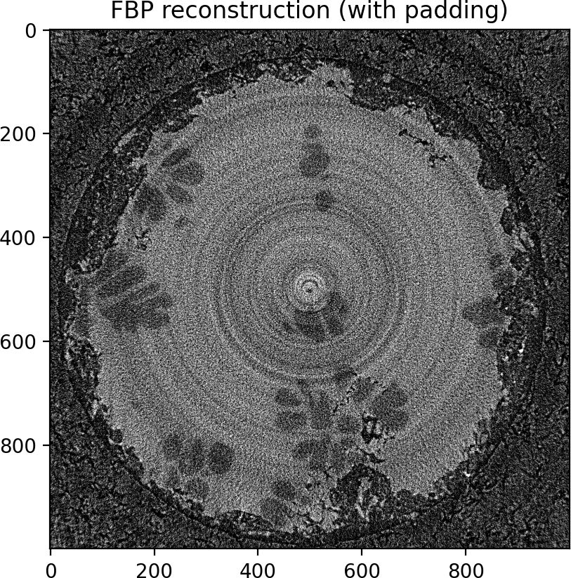
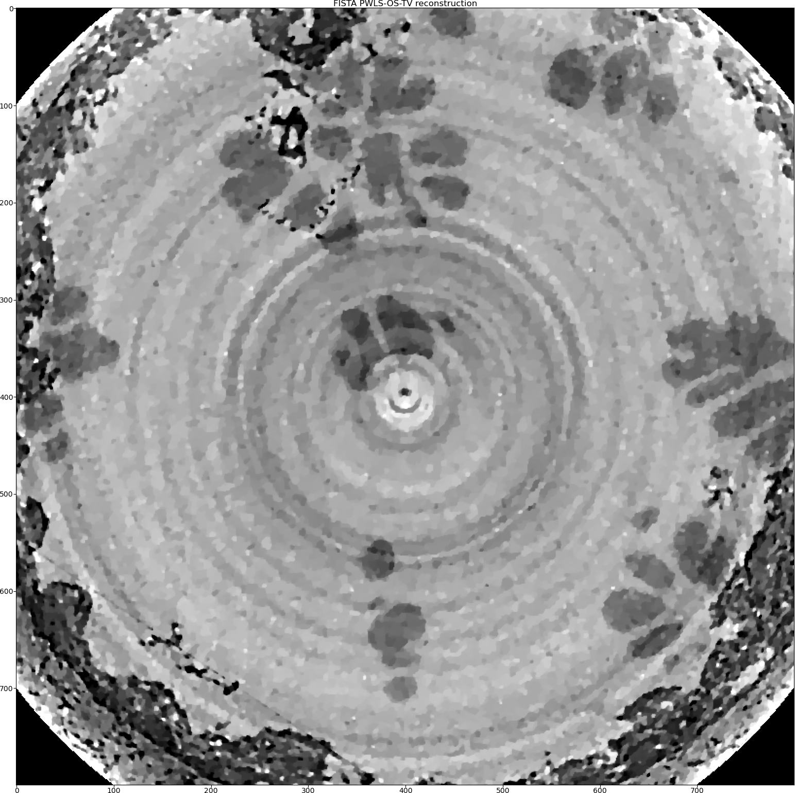
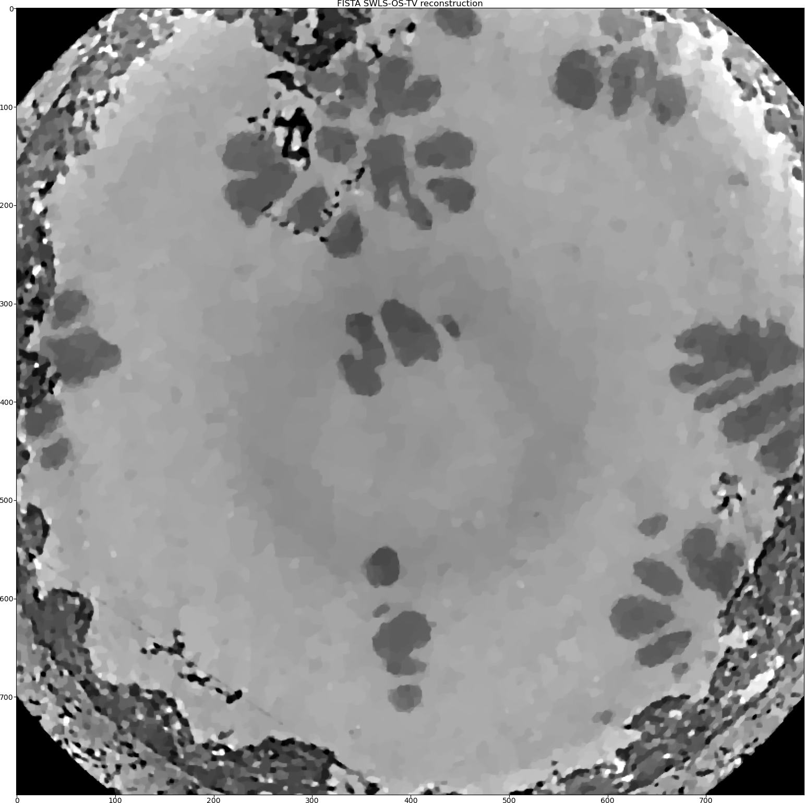

.. _examples_real_data:

Real data reconstruction
************************

.. warning:: The results bellow presented using ToMoBAR version 2026.2.0.1. These examples describe the historical iterative API; current GPU-only reconstruction uses ``tomobar.methodsIR.RecToolsIR`` with explicit geometry objects. This demo will be updated soon.

.. note:: Installing `HTTomolibGPU <https://diamondlightsource.github.io/httomolibgpu/>`_ provides access to a wide range of GPU-accelerated processing tools, in addition to `reconstruction <https://diamondlightsource.github.io/httomolibgpu/reference/methods_list/reconstruction_methods.html>`_ wrappers that leverage ToMoBAR's modules, see point 6 in :ref:`ref_dependencies`.

This tutorial demonstrates real data reconstruction using the ToMoBAR software. The dataset was acquired at the Diamond Light Source synchrotron facility (UK), on the i12 beamline. The sample is a magnesium alloy undergoing thermal cycling, during which dendritic growth occurs.
See more details about the experiment in [GUO2018]_ and more on reconstruction using ToMoBAR in [KAZ2017]_.

This tutorial loosely follows `Demo_RealData.py <https://github.com/dkazanc/ToMoBAR/blob/master/Demos/Python/Demo_RealData.py>`_
demo.

* We will extract a 2D sinogram out of 3D projection data and reconstruct it using the FBP method.

.. code-block:: python

    from tomobar.geometry import Parallel2DGeometry, Volume2DGeometry
    from tomobar.methodsDIR import RecToolsDIR

    Rectools = RecToolsDIR(
        projection_geometry=Parallel2DGeometry(
            angles=angles_rad,
            detector_shape=(detectorHoriz,),
            centre_of_rotation=0.0,
        ),
        volume_geometry=Volume2DGeometry(shape=(N_size, N_size)),
        device_index=0,
    )

    FBPrec = Rectools.FBP(sinogram, data_axes_labels_order=["detX", "angles"])

* In order to remove the circular artifact on the edges of the FBP reconstruction, one can edge-pad the horizontal detector.

.. code-block:: python

    from tomobar.geometry import Parallel2DGeometry, Volume2DGeometry
    from tomobar.methodsDIR import RecToolsDIR

    Rectools = RecToolsDIR(
        projection_geometry=Parallel2DGeometry(
            angles=angles_rad,
            detector_shape=(detectorHoriz,),
            centre_of_rotation=0.0,
        ),
        volume_geometry=Volume2DGeometry(shape=(N_size, N_size)),
        detector_padding=100,
        device_index=0,
    )

    FBPrec = Rectools.FBP(sinogram, data_axes_labels_order=["detX", "angles"])

* Next we reconstruct using ordered-subsets FISTA with Total Variation regularisation.

.. code-block:: python

    from tomobar.geometry import Parallel3DGeometry, Volume3DGeometry
    from tomobar.options import DataFidelity, Regularisation
    from tomobar.methodsIR import RecToolsIR

    Rectools = RecToolsIR(
        projection_geometry=Parallel3DGeometry(
            angles=angles_rad, detector_shape=(1, detectorHoriz), centre_of_rotation=0.0
        ),
        volume_geometry=Volume3DGeometry(shape=(1, N_size, N_size)),
        device_index=0,
        OS_number=6,
    )

    lc = Rectools.powermethod()  # calculate Lipschitz constant

    RecFISTA = Rectools.FISTA(
        sinogram,
        input_axes=["detX", "angles"],
        fidelity=DataFidelity(method="PWLS"),
        weights=sinogram_raw,
        iterations=25,
        lipschitz_constant=lc,
        regularisation=Regularisation(method="PD_TV", strength=2e-06, iterations=60),
    )

* The following historical Group-Huber illustration [PM2015]_ used the retired API.
  The current API supports LS, PWLS, SWLS and KL; the accompanying call uses PWLS.

.. code-block:: python

    from tomobar.options import DataFidelity, Regularisation

    RecFISTA = Rectools.FISTA(
        sinogram,
        input_axes=["detX", "angles"],
        fidelity=DataFidelity(method="PWLS"),
        weights=sinogram_raw,
        iterations=25,
        lipschitz_constant=lc,
        regularisation=Regularisation(method="PD_TV", strength=2e-06, iterations=60),
    )

* We also can try the Stripe-Weighted Least Squares (SWLS) data model [HOA2017]_. Select a different ``DataFidelity`` setting for the same reconstructor.

.. code-block:: python

    from tomobar.geometry import Parallel3DGeometry, Volume3DGeometry
    from tomobar.options import DataFidelity, Regularisation

    Rectools = RecToolsIR(
        projection_geometry=Parallel3DGeometry(
            angles=angles_rad, detector_shape=(1, detectorHoriz), centre_of_rotation=0.0
        ),
        volume_geometry=Volume3DGeometry(shape=(1, N_size, N_size)),
        device_index=0,
        OS_number=6,
    )

    RecFISTA = Rectools.FISTA(
        sinogram,
        input_axes=["detX", "angles"],
        fidelity=DataFidelity(method="SWLS", beta_swls=0.2),
        weights=sinogram_raw,
        iterations=25,
        lipschitz_constant=lc,
        regularisation=Regularisation(method="PD_TV", strength=2e-06, iterations=60),
    )

As one can see that visually the SWLS model produced the best reconstruction here.
This model is indeed works very well when the stripes (rings) are full and not partial.
